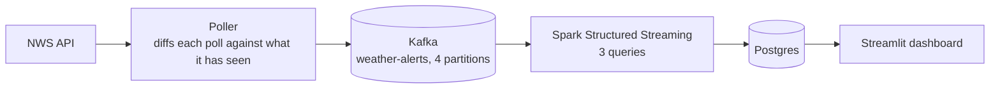
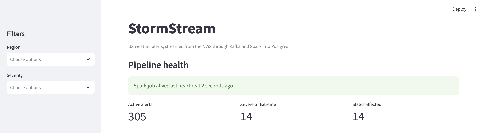
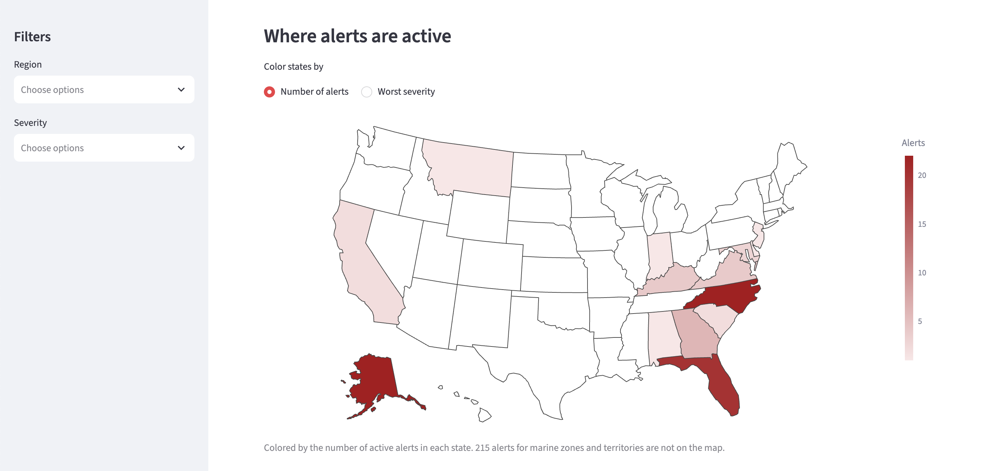
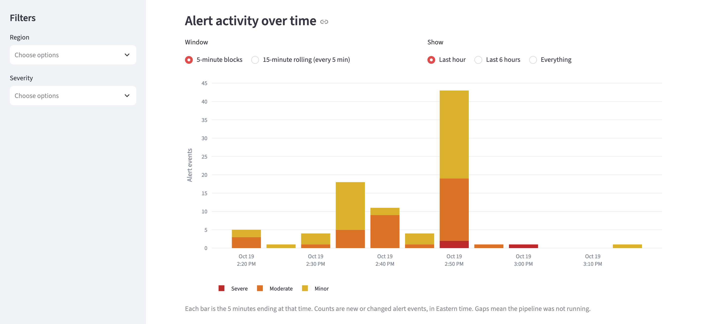
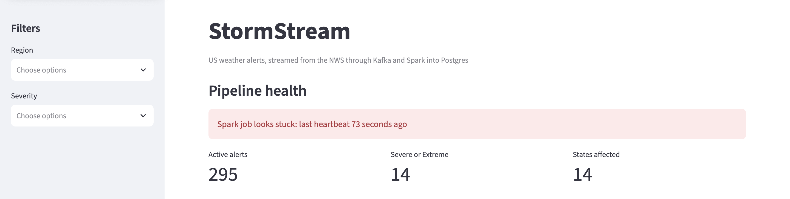

# StormStream

**Real-Time Weather Alert Pipeline** | Python · Kafka · Spark Structured Streaming · PostgreSQL · Streamlit · Docker

[](https://github.com/sloanatkins/stormstream/actions/workflows/tests.yml)

---

## Overview

StormStream is an end-to-end streaming pipeline for US weather alerts. It polls the National Weather Service API, sends only new, changed, and expired alerts through Kafka, processes them with Spark Structured Streaming, stores raw alerts and window counts in Postgres, and shows the results on a live Streamlit dashboard.

The focus here is streaming reliability: duplicate deliveries, bad messages, late data, and a database that goes down. Every one of those was hit while building it, and each has a test or a failure demo.

---

## Architecture



Spark runs three queries off one topic: one writes every valid alert to `raw_alerts` (and rejected messages to a dead letter table), and two count alerts in time windows. The dashboard only reads from Postgres. It never touches Kafka or Spark.

**Stack:** Python · Kafka (KRaft, no ZooKeeper) · PySpark 4 · PostgreSQL 16 · Streamlit · Plotly · Docker Compose · GitHub Actions

| Component | What it does |
|-----------|--------------|
| Poller | Polls the NWS API every 45 seconds, compares against a local SQLite store of what it has seen, and sends only the changes |
| Kafka | Transports and buffers the changes. Messages are keyed by region, 4 partitions |
| Spark | Validates messages, upserts alerts, computes window counts, writes a heartbeat |
| Postgres | Stores alerts, window counts, heartbeats, and rejected messages |
| Dashboard | Health box, metrics, US map, active alerts table, activity chart, dead letters |

---

## Data Model

| Table | Holds | Key |
|-------|-------|-----|
| raw_alerts | One row per alert, latest state only | alert_id |
| alert_window_agg | Alert counts per time window, region, and severity | window_type, window_start, region, severity |
| pipeline_heartbeat | One row per Spark batch, plus idle rows when nothing arrives | id |
| dead_letter_events | Messages Spark rejected, with the raw text and a reason | kafka_partition, kafka_offset |

All writes are upserts, so a message delivered twice does not create a second row. Timestamps are stored as TIMESTAMPTZ in UTC and shown in Eastern time on the dashboard.

---

## Streaming Queries

| Query | What it does | Output |
|-------|--------------|--------|
| raw_alerts | Parses each message, upserts valid ones, sends invalid ones to dead letters | raw_alerts, dead_letter_events |
| tumbling_5m | Counts alert events in 5 minute blocks | alert_window_agg |
| sliding_15m | Counts alert events in 15 minute windows that move every 5 minutes | alert_window_agg |

Micro-batches run every 10 seconds. The window queries use a 10 minute watermark on `ingested_at` (when the poller picked up the change) and drop duplicate deliveries inside the watermark. Both run in update mode, so only windows whose count changed are written.

---

## Reliability

| What goes wrong | What the pipeline does |
|-----------------|------------------------|
| Kafka delivers the same message twice | Upserts make `raw_alerts` safe to replay. The window queries drop duplicates within the watermark, so counts do not double |
| A message is not JSON, is missing a field, or has an invalid value | It goes to `dead_letter_events` with the raw text and a reason. The row is stored once per Kafka partition and offset |
| A timestamp is malformed | Parsed with `try_cast`, so it becomes a rejected message. A plain cast crashes the job in Spark 4 and loops on the same message forever |
| Postgres goes down | Each write retries up to 6 times with growing waits. The heartbeat stops, so the dashboard health box turns red, then recovers when Postgres is back |
| No alerts arrive for a while | The Spark main loop writes an idle heartbeat, so a quiet pipeline looks different from a dead one |
| The Spark job crashes | The heartbeat stops and the health box turns red after 60 seconds |
| The poller restarts | The SQLite store remembers what was already sent, so only real changes go to Kafka |
| Kafka is down when the poller runs | The poller saves its state only after Kafka confirms the send, so the same changes are sent again next cycle. Repeated failures back off, capped at 10 minutes |
| An alert leaves the NWS feed | The next poll sends it as `expired` |

---

## Dashboard

Streamlit + Plotly, reading Postgres only. The live section refreshes itself every 15 seconds.

**Overview** — Pipeline health, headline numbers, and a US map colored by alert count or worst severity.





**Alert Activity** — Alert events over time in 5 minute blocks or a 15 minute rolling view, stacked by severity. Click a legend entry to show only that severity.



**Failure Demo** — The health box after the Spark job was stopped. It turns red within a minute and recovers when the job restarts.



---

## Tests and CI

30 tests: 8 for the poller's diff logic, 12 for NWS parsing, and 10 for the Spark parsing logic, which run on a small local Spark session. A smoke test (`scripts/smoke_test.sh`, 9 checks) verifies that Kafka and Postgres are healthy and that a message goes through Kafka and reads back.

GitHub Actions runs the test suite on every push to main and on pull requests (Python 3.12, Java 21).

---

## Project Structure

```
stormstream/
├── poller/
│   ├── main.py              # Poll loop: fetch, clean, diff, send
│   ├── nws.py               # NWS API client and alert cleaning
│   ├── diff.py              # New / updated / expired detection
│   ├── store.py             # SQLite store of what has been seen
│   └── producer.py          # Kafka producer
├── streaming/
│   ├── stream_alerts.py     # Spark job: three queries, heartbeat, retries
│   └── parsing.py           # Message parsing and validation
├── dashboard/
│   └── app.py               # Streamlit dashboard
├── docker/
│   ├── docker-compose.yml   # Kafka + Postgres
│   └── postgres/init/       # Table definitions (001 to 003)
├── scripts/
│   └── smoke_test.sh        # Stack health check
├── tests/                   # 30 tests
├── .github/workflows/
│   └── tests.yml            # CI
├── decisions.md             # Running log of design decisions
├── .env.example
└── requirements.txt
```

---

## Running Locally

Prerequisites: Python 3.12, Docker Desktop, Java 17 or newer (CI uses 21). No API key is needed for the NWS.

```bash
git clone https://github.com/sloanatkins/stormstream
cd stormstream
cp .env.example .env
pip install -r requirements.txt
docker compose -f docker/docker-compose.yml --env-file .env up -d
bash scripts/smoke_test.sh
```

Then start the three programs, each in its own terminal, in this order:

```bash
python streaming/stream_alerts.py     # Spark job (the first start downloads the Kafka connector)
python -m poller.main                 # poller
streamlit run dashboard/app.py        # dashboard
```

Run the tests with `python -m pytest tests -v`. Stop the stack with `docker compose -f docker/docker-compose.yml --env-file .env down`.

---

## Key Technical Decisions

**Kafka only transports, the sinks are idempotent:** Kafka delivers at least once, so duplicates are expected. Every write to Postgres is an upsert, which makes replaying safe.

**The poller sends changes, not snapshots:** Sending all ~350 active alerts every 45 seconds would bury the real changes. A fingerprint of event type, severity, and expiry decides what counts as a change.

**Keyed by region:** Alerts for the same region stay in order on one partition.

**foreachBatch with psycopg2 instead of Spark's JDBC writer:** The JDBC writer can only append or overwrite. Upserts with `ON CONFLICT` need hand-written SQL.

**Windows count when the pipeline saw a change, not when the alert was issued:** An alert issued hours ago can show up for the first time now, so event time is `ingested_at`.

**Spark and the poller run on the host, Docker runs Kafka and Postgres:** It keeps the edit-and-rerun loop fast during development.

More detail on each decision, including what went wrong along the way, is in `decisions.md`.

---

## Known Limitations

- **Startup spike.** On a fresh start the poller reports every currently active alert as new, so the activity chart has one large bar. The dashboard's "Last hour" view hides it once it is old enough. A proper fix means flagging snapshot messages through the whole pipeline, which I judged too heavy for this project.
- **About a minute of latency locally.** Three queries share one laptop, so batches take 40 to 65 seconds against a 10 second trigger.
- **Window counts are events, not distinct alerts.** Duplicates that arrive outside the dedupe window can still be counted twice.
- **CI runs unit tests only.** There is no job that starts Kafka and Postgres. The full stack is checked by the smoke test and by running it.
- **Local only.** It runs on a laptop and is not deployed, so there are gaps when the machine is off, and the dashboard says so.
- **Small loose ends.** The `consumer_lag` column exists but is not filled in, and the Spark job has the Kafka address and topic name hardcoded.

---

<i>Sloan M. Atkins · University of Miami · CS + Mathematics, Class of 2027</i><br>
<i>Data Engineering Portfolio · Project 4 of 4</i>
